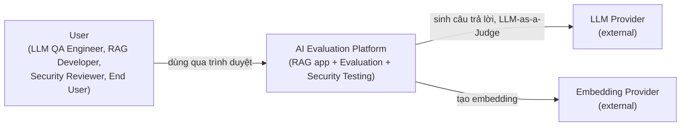
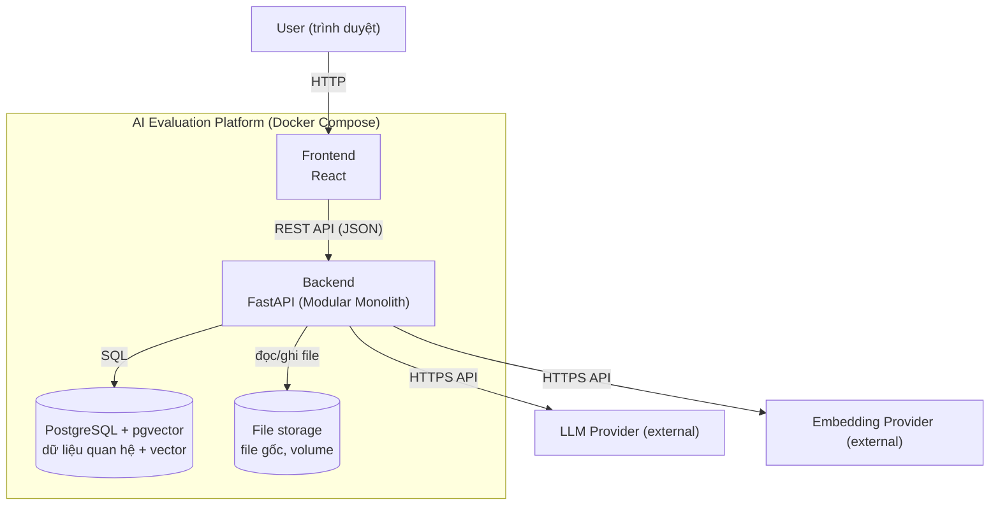
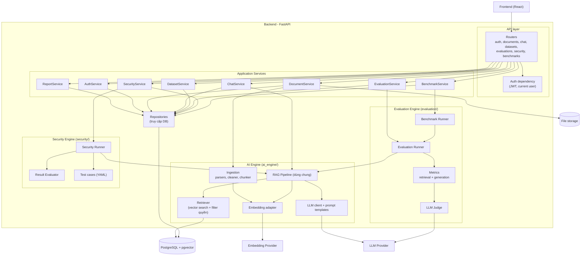

# 04. Kiến trúc tổng thể (M1-T04)

Trạng thái: bản nháp chờ duyệt. Các lựa chọn công nghệ cụ thể (LLM provider, embedding provider, kích thước vector) được chốt ở M1-T06; tài liệu này chỉ dùng tên vai trò như "LLM Provider".

## 1. Nguyên tắc kiến trúc

- **Modular Monolith**: một ứng dụng backend, chia module có ranh giới rõ. Không tách microservices.
- **Một RAG pipeline duy nhất** (`ai_engine/pipeline/rag_pipeline.py`) dùng chung cho Chat, Evaluation, Benchmark và Security.
- **Phân tầng**: Router (nhận request, validate) → Service (use case, orchestration) → AI Engine / Evaluation / Security (logic miền) → Repository (truy cập DB).
- **Frontend chỉ gọi backend API.** Không nối DB, không giữ API key của provider.
- **Phân biệt module logic và service triển khai riêng**: xem mục 3.

## 2. Sơ đồ

### 2.1 System Context

### 2.2 Container

### 2.3 Component (bên trong Backend)

## 3. Module logic và đơn vị triển khai

| Đơn vị | Loại | Giải thích |
|--------|------|------------|
| Frontend (React) | Triển khai riêng (container) | Giao diện, chỉ gọi REST API |
| Backend (FastAPI) | Triển khai riêng (container) | Chứa **tất cả** module logic bên dưới trong một process |
| PostgreSQL + pgvector | Triển khai riêng (container) | Dữ liệu quan hệ và vector |
| File storage | Volume gắn vào backend | File gốc người dùng upload |
| LLM / Embedding Provider | Dịch vụ ngoài | Không do dự án vận hành |
| Ingestion, RAG Engine, Dataset, Evaluation, Security, Benchmark, Dashboard & Reporting | **Module logic** trong backend | Tách thư mục và interface, không tách process |

Lý do không dùng microservices: một người phát triển, chưa có yêu cầu mở rộng độc lập từng module, và tách service làm tăng độ phức tạp vận hành (mạng, version, debug) mà MVP chưa cần.

## 4. Bảng mô tả component

Mỗi module trong 7 module của Master Prompt. Vị trí là thư mục trong repo.

### 4.1 Document Ingestion

| Mục | Mô tả |
|-----|-------|
| Responsibility | Nhận file, kiểm tra, trích văn bản, làm sạch, chunk, embed, lưu; theo dõi trạng thái xử lý và lỗi |
| Vị trí | `ai_engine/ingestion/`, `ai_engine/chunking/`, `ai_engine/embeddings/`; điều phối ở `backend/app/services/document_service.py`; route `backend/app/api/routes/documents.py` |
| Input | File PDF/DOCX/TXT, user_id, cấu hình chunk (size, overlap) |
| Output | Bản ghi Document, các DocumentChunk kèm vector, trạng thái xử lý |
| Dependency | Embedding Provider, Repository, File storage |
| Caller / Callee | Gọi bởi DocumentService; gọi Embedding adapter và Repository |
| Storage | File gốc trong file storage; metadata và chunk trong PostgreSQL; vector trong cột pgvector gắn với chunk |
| Failure handling | File hỏng: trạng thái failed kèm lý do, không sập tiến trình; embedding lỗi hoặc rate limit: retry có giới hạn rồi failed; upload trùng, xóa, reprocess theo `05_sequences.md` |
| Tests | Unit: parser, cleaner, chunker; integration: upload đến lưu vector với embedding giả; test cô lập user |

### 4.2 RAG Engine

| Mục | Mô tả |
|-----|-------|
| Responsibility | Embed câu hỏi, retrieval có phân quyền, dựng context và prompt, gọi LLM, trả câu trả lời và trích dẫn, ghi latency/token/chi phí, xử lý không đủ bằng chứng |
| Vị trí | `ai_engine/retrieval/`, `ai_engine/generation/`, `ai_engine/pipeline/`; điều phối ở `backend/app/services/chat_service.py` |
| Input | Câu hỏi, user_id, RAGConfig (model, embedding, prompt version, Top-K, temperature) |
| Output | Answer, citations, retrieved contexts kèm điểm, latency, token, chi phí ước tính |
| Dependency | Embedding Provider, LLM Provider, pgvector |
| Caller / Callee | Gọi bởi ChatService, Evaluation Runner và Security Runner (Benchmark Runner dùng gián tiếp qua Evaluation Runner); gọi Embedding adapter, Retriever, LLM client |
| Storage | Đọc chunk và vector; ghi ChatMessage và RetrievedContext qua Repository (khi gọi từ Chat) |
| Failure handling | LLM timeout hoặc rate limit: retry có giới hạn, trả lỗi rõ cho caller; không có context đủ liên quan: trả câu "không đủ thông tin" |
| Tests | Unit: context builder, xử lý không đủ context; integration: pipeline với provider giả; test chứng minh lọc quyền retrieval; pipeline gọi được từ script không cần FastAPI |

### 4.3 Evaluation Dataset

| Mục | Mô tả |
|-----|-------|
| Responsibility | Quản lý dataset, version, test case; import; duyệt và đóng băng version |
| Vị trí | `backend/app/services/dataset_service.py`, `backend/app/models/dataset.py`, `evaluation/datasets/` (loader); route `backend/app/api/routes/datasets.py` |
| Input | Dữ liệu test case (câu hỏi, ground truth, reference contexts, nguồn, loại, độ khó, hành vi mong đợi), file CSV/JSON |
| Output | Dataset, DatasetVersion, EvaluationTestCase |
| Dependency | Repository |
| Caller / Callee | Gọi bởi DatasetService và Evaluation Runner (đọc test case) |
| Storage | PostgreSQL |
| Failure handling | Import sai định dạng: từ chối và báo dòng lỗi; sửa version đã duyệt: từ chối |
| Tests | Unit: validate schema; integration: import, tạo version, bất biến sau khi duyệt |

### 4.4 Evaluation Engine

| Mục | Mô tả |
|-----|-------|
| Responsibility | Chạy từng test case qua RAG pipeline, tính retrieval metrics và generation metrics, tổng hợp, lưu kết quả, ghi metadata run |
| Vị trí | `evaluation/runners/`, `evaluation/metrics/`, `evaluation/evaluators/`; điều phối ở `backend/app/services/evaluation_service.py` |
| Input | Dataset version, RAGConfig, cấu hình judge |
| Output | EvaluationRun, EvaluationResult từng case, MetricResult |
| Dependency | RAG Pipeline, LLM Provider (judge); lưu kết quả qua callback do Service truyền vào (runner không gọi Repository) |
| Caller / Callee | Gọi bởi EvaluationService và Benchmark Runner; gọi RAG Pipeline và Metrics |
| Storage | PostgreSQL |
| Failure handling | Lỗi một case được lưu theo case, run vẫn hoàn tất; judge lỗi: đánh dấu metric không tính được, không điền số giả |
| Tests | Unit: metric là hàm thuần, so ví dụ tính tay; integration: runner với pipeline và judge giả; test một case lỗi không hỏng run |

### 4.5 AI Security Testing

| Mục | Mô tả |
|-----|-------|
| Responsibility | Nạp test case bảo mật, chạy qua RAG pipeline có kiểm soát, so hành vi thực tế với mong đợi, gán pass/fail và severity, lưu evidence và khuyến nghị |
| Vị trí | `security/test_cases/`, `security/runners/`, `security/evaluators/`, `security/reports/`; điều phối ở `backend/app/services/security_service.py` |
| Input | Test case YAML, tài khoản và tài liệu thử nghiệm (dữ liệu giả, canary token) |
| Output | SecurityTestRun, SecurityTestResult (pass/fail, severity, evidence, mitigation) |
| Dependency | RAG Pipeline, LLM Provider (nếu dùng judge); lưu kết quả qua callback do Service truyền vào (runner không gọi Repository) |
| Caller / Callee | Gọi bởi SecurityService; gọi RAG Pipeline và Result Evaluator |
| Storage | Test case: file YAML trong repo (và bản ghi trong DB khi chạy); kết quả: PostgreSQL |
| Failure handling | Một test case lỗi không làm hỏng cả run; ghi rõ giới hạn độ phủ trong báo cáo |
| Tests | Unit: loader validate schema, evaluator với ca pass và fail (có canary token); integration: chạy bộ test mẫu |

### 4.6 Benchmarking

| Mục | Mô tả |
|-----|-------|
| Responsibility | So sánh nhiều cấu hình (MVP: LLM, Top-K, prompt; chunking và embedding là Deferred) trên cùng dataset version và điều kiện kiểm soát; ghi chất lượng, latency, token, chi phí |
| Vị trí | `evaluation/benchmarks/`; điều phối ở `backend/app/services/benchmark_service.py` |
| Input | Dataset version, danh sách cấu hình cần so sánh (mỗi lần đổi một biến chính) |
| Output | BenchmarkRun liên kết các EvaluationRun con |
| Dependency | Evaluation Runner |
| Caller / Callee | Gọi bởi BenchmarkService; gọi Evaluation Runner cho từng cấu hình |
| Storage | PostgreSQL |
| Failure handling | Một cấu hình lỗi: ghi nhận và tiếp tục các cấu hình còn lại |
| Tests | Integration: benchmark hai cấu hình với provider giả, kiểm tra các run con dùng cùng dataset version |

### 4.7 Dashboard và Reporting

| Mục | Mô tả |
|-----|-------|
| Responsibility | Hiển thị tổng quan, quản lý document, chat, dataset, kết quả evaluation, báo cáo bảo mật, so sánh model, lịch sử run; xuất CSV (PDF là deferred) |
| Vị trí | Frontend: `frontend/src/pages/`, `frontend/src/services/api/`; Backend: `backend/app/services/report_service.py`, `evaluation/reports/`, `security/reports/` |
| Input | Dữ liệu run, kết quả, cấu hình đã lưu |
| Output | Trang giao diện, file CSV, báo cáo |
| Dependency | REST API của backend, Repository |
| Caller / Callee | Frontend gọi API; ReportService đọc qua Repository |
| Storage | Bản ghi `reports` (lịch sử xuất) trong PostgreSQL; CSV sinh tức thì và trả trực tiếp, không lưu file |
| Failure handling | Giao diện có trạng thái loading và lỗi; báo cáo chỉ dùng dữ liệu thật đã lưu |
| Tests | Integration: nội dung CSV khớp DB; E2E: kịch bản xem báo cáo |

## 5. Thành phần xuyên suốt

| Thành phần | Vị trí | Vai trò |
|------------|--------|---------|
| Auth (JWT, current user) | `backend/app/core/security.py`, `backend/app/api/dependencies.py` | Xác thực và cấp quyền cho mọi router |
| Config | `backend/app/core/config.py`, `configs/` | Đọc cấu hình và secret từ biến môi trường |
| Logging và lỗi chuẩn | `backend/app/core/logging.py`, `backend/app/core/exceptions.py` | Log không chứa dữ liệu nhạy cảm; lỗi JSON thống nhất |
| Repository | `backend/app/repositories/` | Mọi truy cập DB đi qua đây; Service không truy cập DB trực tiếp |

### Ngoại lệ có chủ đích với quy tắc "chỉ Repository truy cập DB"

1. `ai_engine/retrieval/vector_retriever.py` chạy câu SQL tìm vector và lọc quyền, vì truy vấn vector gắn chặt với logic lọc `user_id`. Nó **không import `backend/app`**: caller (Service) truyền vào một DB session. Nhờ đó pipeline vẫn gọi được từ script độc lập (truyền một session bất kỳ).
2. `GET /health` chạy `SELECT 1` qua session để kiểm tra kết nối.
3. Runner (`evaluation`, `security`) **không** truy cập DB: Service truyền callback để runner báo từng kết quả, Service lưu qua Repository.

## 6. Quyết định đã chọn và lý do

Cả ba điểm dưới đây đã chọn theo phương án nêu; lý do và giả định yếu ghi ở mục 7. Đổi được trước khi sang Milestone 2.

1. **Xử lý ingestion chạy nền**: dùng cơ chế chạy nền có sẵn của FastAPI (không thêm Celery hay Redis). Upload trả về ngay với trạng thái `uploaded`, tiến trình xử lý cập nhật `processing`, rồi `ready` hoặc `failed`. Hạn chế: tác vụ nền mất khi backend khởi động lại; chấp nhận được cho MVP và sẽ ghi vào danh sách rủi ro.
2. **File storage**: dùng volume cục bộ của Docker cho MVP; đường dẫn lưu trong bảng Document.
3. **Evaluation và Security chạy với user nào**: chạy dưới danh nghĩa user sở hữu corpus, dùng cùng cơ chế lọc quyền như Chat, để test Access Control phản ánh đúng hệ thống thật.

## 7. Lý do, giả định yếu và khái niệm

### 7.1 Vì sao Modular Monolith, không phải microservices

Microservices giải quyết bài toán *nhiều đội cùng sửa một hệ thống lớn và cần mở rộng từng phần độc lập*. Dự án này không có bài toán đó: một người, một DB, các module chia sẻ chặt chẽ dữ liệu (chunk, run, kết quả). Tách service chỉ thêm chi phí: gọi qua mạng, quản lý phiên bản giữa các service, debug phân tán, giao dịch DB bị chia cắt. Modular Monolith giữ ranh giới rõ bằng thư mục và interface, và nếu sau này thật sự cần tách (ví dụ Evaluation chạy nặng), ranh giới đã sẵn để cắt.

*Giả định yếu:* "ranh giới thư mục sẽ tự được giữ". Thực tế ranh giới bị phá dần khi code import chéo. Vì vậy `09_repo_manifest.md` mục 4 ghi quy tắc phụ thuộc, và audit cuối (M9-T07) kiểm tra lại.

### 7.2 Vì sao chỉ một RAG pipeline

Nếu Chat, Evaluation và Security mỗi nơi tự gọi retrieval và LLM theo cách riêng, điểm đánh giá sẽ đo một hệ thống *khác* với hệ thống người dùng dùng thật, và lỗi bảo mật tìm thấy có thể không tồn tại ở chat thật (hoặc ngược lại). Dùng một pipeline đảm bảo "thứ ta đo là thứ ta chạy".

### 7.3 Các quyết định ở mục 6

| Quyết định | Lý do chọn | Giả định yếu và cách kiểm chứng |
|------------|------------|---------------------------------|
| Ingestion và evaluation chạy nền bằng cơ chế sẵn có của FastAPI | Upload và run kéo dài hơn một request HTTP bình thường; chạy nền cho phép trả `202` ngay và poll trạng thái. Không thêm Celery hay Redis vì chưa có bằng chứng cần hàng đợi phân tán | *"Mất tác vụ khi restart là chấp nhận được."* Với MVP một người dùng thì đúng, nhưng phải có cơ chế đánh dấu tác vụ kẹt (R9) và có test. Nếu thực tế hay mất việc dở, đó là bằng chứng để cân nhắc hàng đợi |
| File gốc lưu volume cục bộ | Đơn giản, đủ cho một máy; đường dẫn lưu trong DB nên đổi sang object storage sau này chỉ sửa `file_storage.py` | *"Một máy là đủ."* Đúng cho demo và portfolio; ghi rõ là giới hạn khi triển khai nhiều máy |
| Evaluation và Security chạy dưới user sở hữu corpus | Dùng đúng đường lọc quyền như Chat nên Access Control test phản ánh hệ thống thật; không cần "tài khoản hệ thống" có quyền đặc biệt (là rủi ro bảo mật tiềm tàng) | *"Một user là đủ để test cô lập."* Không đủ: test Access Control phải dùng **hai** user để chứng minh cô lập; runner phải chuẩn bị cả hai |

### 7.4 Khái niệm cho người mới

- **Router, Service, Repository** (ba lớp trong backend): Router nhận request và kiểm tra hình dạng dữ liệu; Service chứa quy tắc nghiệp vụ và điều phối ("upload xong thì parse rồi embed"); Repository là nơi duy nhất nói chuyện với DB. Tách như vậy để thay đổi một lớp không phá lớp khác, và để test Service mà không cần DB thật (thay Repository bằng bản giả).
- **Interface và adapter**: interface là "hợp đồng" (ví dụ: nhận danh sách văn bản, trả danh sách vector). Adapter là phần cài hợp đồng cho một nhà cung cấp cụ thể. Pipeline chỉ biết hợp đồng, nên thay provider hay thay bằng bản giả khi test đều không đụng pipeline.
- **Logical module và service triển khai riêng**: module logic là cách *tổ chức code*; service triển khai riêng là cách *chạy process*. Dự án có nhiều module logic nhưng chỉ ba thứ chạy riêng (frontend, backend, db).
- **Citation (trích dẫn nguồn)**: mỗi câu trả lời kèm các chunk đã dùng, để người dùng kiểm chứng, và để ta kiểm tra "câu trả lời có được hỗ trợ bởi context không" (Faithfulness).
