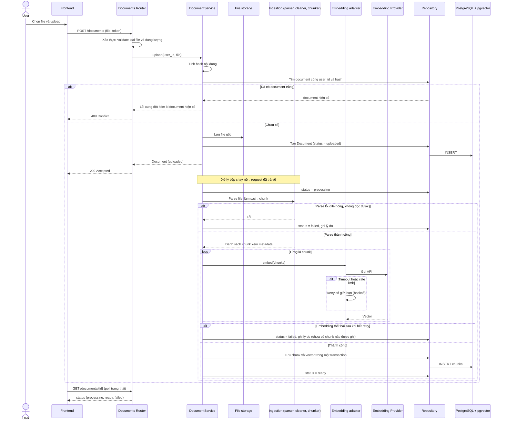
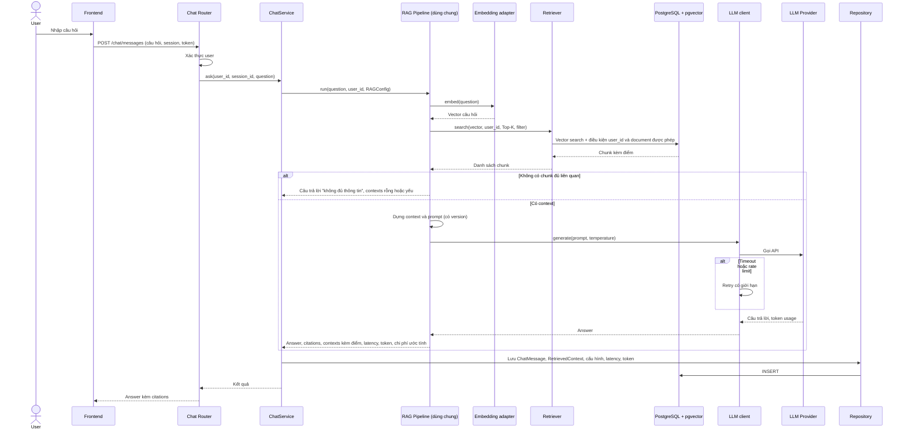
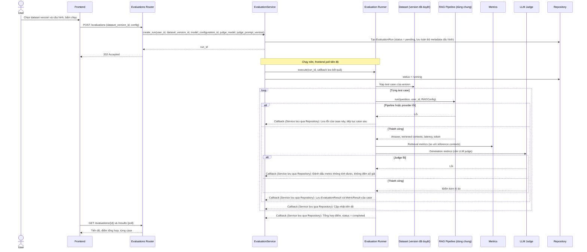
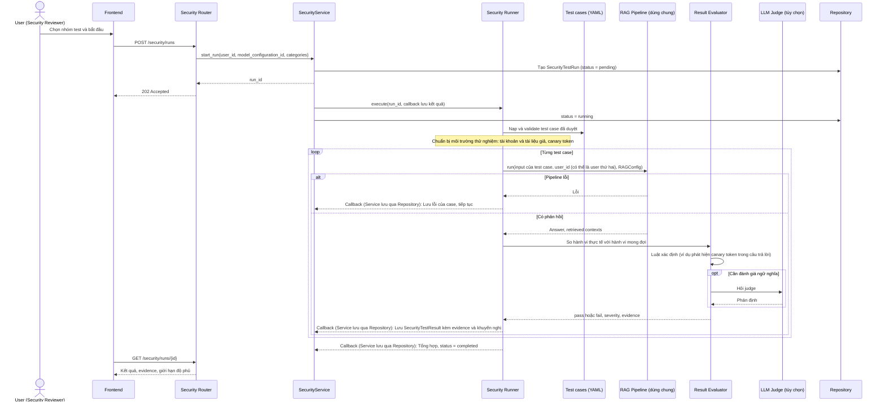

# 05. Sơ đồ Sequence (M1-T05)

Trạng thái: bản nháp chờ duyệt. Khớp với mục 5.1 đến 5.4 của Master Prompt. Số lần retry và timeout là cấu hình, không cố định trong tài liệu.

## Điểm tái sử dụng RAG Pipeline

`RAG Pipeline` (`ai_engine/pipeline/rag_pipeline.py`) là điểm dùng chung. Ba luồng dưới đây (RAG, Evaluation, Security) đều gọi **cùng một hàm** của pipeline; luồng Benchmark gọi qua Evaluation Runner nên cũng dùng lại. Khác biệt chỉ nằm ở caller và nơi lưu kết quả:

| Caller | Đầu vào RAGConfig từ | Kết quả lưu vào |
|--------|----------------------|-----------------|
| ChatService | Cấu hình mặc định hoặc user chọn | ChatMessage, RetrievedContext |
| Evaluation Runner | Cấu hình của EvaluationRun | EvaluationResult, MetricResult |
| Benchmark Runner | Cấu hình từng nhánh benchmark, qua Evaluation Runner | EvaluationRun con của BenchmarkRun |
| Security Runner | Cấu hình của SecurityTestRun | SecurityTestResult |

## Ghi chú về lưu kết quả của runner

Evaluation Runner và Security Runner **không gọi Repository** (quy tắc phụ thuộc ở `09_repo_manifest.md` mục 4). Service truyền vào một callback; runner gọi callback để báo lỗi, kết quả từng case và tiến độ, Service lưu qua Repository. Trong các sơ đồ dưới, mũi tên `RUN-->>SVC: Callback` thể hiện điều này.

## 1. Document Ingestion (mục 5.1)

### Hành vi khác trong luồng ingestion

| Tình huống | Hành vi |
|------------|-----------------|
| **Upload trùng** | So hash nội dung trong cùng user. Trùng thì từ chối với 409 và trả id document đã có. Hai user khác nhau upload cùng file thì mỗi người có bản riêng (cô lập dữ liệu). |
| **Retry** | Chỉ retry lỗi tạm thời (timeout, rate limit, lỗi 5xx của provider), số lần và thời gian chờ cấu hình được. Không retry lỗi do dữ liệu (file hỏng). |
| **Xóa document** | Xóa chunk (cascade), xóa file gốc, xóa bản ghi Document. Nếu xóa file lỗi thì ghi log và không để lại chunk mồ côi. Các bản ghi lịch sử (ChatMessage, RetrievedContext) cần tham chiếu an toàn; quy tắc cascade chi tiết ở `07_database.md` mục 6. |
| **Reprocess** | Chuyển status về processing, xóa chunk cũ và ghi chunk mới trong cùng một transaction để không tạo chunk trùng. Thất bại thì giữ trạng thái failed kèm lý do. |
| **Tiến trình bị gián đoạn** (backend khởi động lại giữa chừng) | Document kẹt ở processing. Cần cơ chế phát hiện (ví dụ quá hạn thì đánh dấu failed để user reprocess). Ghi vào rủi ro, chốt ở M3. |

## 2. RAG: hỏi đáp (mục 5.2)

Lọc quyền diễn ra **trong câu truy vấn vector** (điều kiện `user_id` và document được phép), không chỉ ở API, nên một câu hỏi cố tình nhắm vào dữ liệu của user khác cũng không nhận được chunk của họ.

Lỗi provider kéo dài (hết retry): pipeline trả lỗi rõ cho caller; ChatService trả lỗi chuẩn cho frontend, không bịa câu trả lời.

## 3. Evaluation (mục 5.3)

Bản ghi `EvaluationRun` lưu: dataset version, model và version, embedding model, prompt version, chunk size, overlap, Top-K, temperature, framework version, model và prompt của judge, timestamp. Run chỉ được đánh dấu `completed` sau khi mọi case đã có kết quả hoặc lỗi được ghi.

Nếu backend khởi động lại giữa lúc chạy, run kẹt ở `running`; cần cơ chế đánh dấu lại (chốt ở M6, cùng loại với trường hợp ingestion).

## 4. Security Testing (mục 5.4)

Phạm vi: chỉ chạy trên ứng dụng RAG do dự án kiểm soát, với dữ liệu giả và canary token. Test Access Control dùng hai user khác nhau để chứng minh cô lập. Báo cáo cuối nêu rõ nhóm hoặc kịch bản chưa kiểm tra và không kết luận "an toàn tuyệt đối".

## 5. Đối chiếu với Master Prompt

| Mục Master Prompt | Sơ đồ | Điểm khớp |
|-------------------|-------|-----------|
| 5.1 Document ingestion | Mục 1 | Xác thực, validate, lưu file gốc, parser, preprocessing, chunker, embedding, lưu chunk và vector, trả status; có retry, lỗi, trùng, xóa, reprocess |
| 5.2 Question answering | Mục 2 | Xác thực, kiểm tra quyền, embed câu hỏi, retrieval có filter, dựng context và prompt, gọi LLM, citations, ghi log, xử lý thiếu bằng chứng |
| 5.3 Evaluation | Mục 3 | Run gắn dataset version và cấu hình, gọi cùng pipeline với chat, lưu answer và contexts, tính metric, tổng hợp, giữ lỗi từng case |
| 5.4 Security testing | Mục 4 | Nạp test case đã duyệt, chạy trên ứng dụng kiểm soát, so sánh mong đợi và thực tế, pass/fail và severity, lưu evidence, nêu giới hạn |
