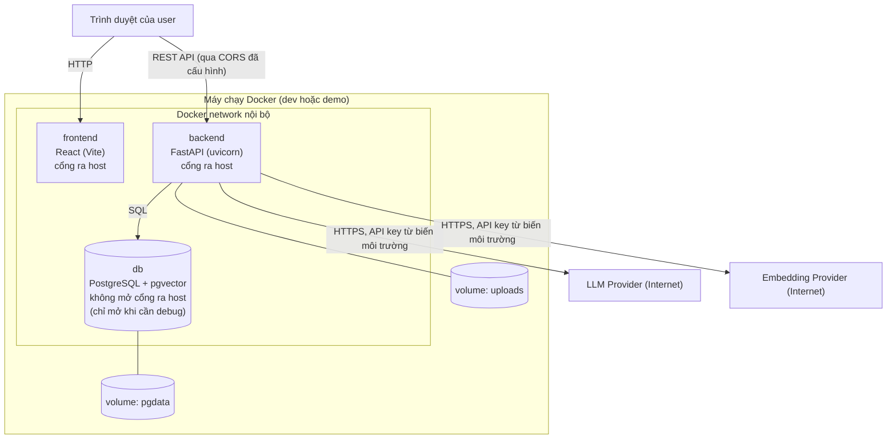

# 06. Deployment diagram và rà soát Technology Stack (M1-T06)

Trạng thái: bản nháp chờ duyệt. Hai quyết định ở mục 4 (LLM/embedding provider và Ragas/DeepEval) đã được chọn kèm lý do; bạn vẫn đổi được trước M3-T01. Tên model cụ thể, phiên bản thư viện và giá phải được xác minh lại khi cài đặt (M3, M4), tài liệu này không cố định chúng.

## 1. Deployment diagram (Docker Compose)

Ghi chú: trình duyệt gọi API trực tiếp tới backend (không qua reverse proxy trong MVP). Reverse proxy như Nginx là tùy chọn, không bắt buộc.

### Các service trong `docker-compose.yml`

| Service | Image / build | Vai trò | Phụ thuộc | Health check |
|---------|---------------|---------|-----------|--------------|
| `db` | Image PostgreSQL có sẵn pgvector | Dữ liệu quan hệ và vector | Không | `pg_isready` |
| `backend` | Build từ `backend/Dockerfile` | FastAPI, mọi module logic | `db` ở trạng thái healthy | `GET /health` (kiểm tra cả kết nối DB) |
| `frontend` | Build từ `frontend/Dockerfile` | Giao diện | `backend` | Phản hồi trang chủ |

### Volume, network, biến môi trường

| Hạng mục | Quyết định |
|----------|--------------------|
| Volume `pgdata` | Giữ dữ liệu DB sau khi restart (kiểm chứng ở M2-T03) |
| Volume `uploads` | Lưu file gốc, gắn vào `backend` tại `UPLOAD_DIR` |
| Network | Một network nội bộ do Compose tạo; `db` chỉ truy cập được từ `backend` |
| Cổng `db` | Không công bố ra host mặc định |
| Migration | Chạy `alembic upgrade head` khi backend khởi động trong Compose, và có lệnh thủ công được ghi trong README |
| Logs | Ghi ra stdout, xem bằng `docker compose logs`; không ghi nội dung tài liệu, câu hỏi nhạy cảm hay secret |
| Kết nối LLM | Chỉ `backend` ra Internet; frontend không bao giờ giữ API key |

Biến môi trường (chỉ liệt kê tên; giá trị nằm trong `.env`, mẫu ở `.env.example`):

| Nhóm | Biến |
|------|------|
| Database | `POSTGRES_USER`, `POSTGRES_PASSWORD`, `POSTGRES_DB`, `DATABASE_URL` |
| Auth | `JWT_SECRET`, `JWT_EXPIRE_MINUTES` |
| Provider | `LLM_API_KEY`, `EMBEDDING_API_KEY` (và tên provider, model nếu cần) |
| Upload | `UPLOAD_DIR`, `MAX_UPLOAD_SIZE_MB`, danh sách loại file cho phép |
| Frontend | `VITE_API_BASE_URL` |
| Web | `CORS_ALLOWED_ORIGINS` |

## 2. Rà soát Technology Stack

Nhãn: **Essential** (bắt buộc cho MVP), **Optional** (có thể thêm nếu cần), **Unnecessary** (không dùng, theo nguyên tắc tránh framework thừa).
Độ khó học: T thấp, TB trung bình, C cao, so với nền tảng IT/InfoSec của bạn.

### 2.1 Backend

| Công nghệ | Mục đích | Phương án thay thế | Ưu / Nhược | Độ khó | Nhãn |
|-----------|----------|--------------------|------------|--------|------|
| Python | Ngôn ngữ chính cho backend, AI, evaluation | Không (hệ sinh thái AI nằm ở Python) | Thư viện AI đầy đủ / chậm hơn ngôn ngữ biên dịch, không quan trọng ở đây | T | Essential |
| FastAPI | REST API, validate request bằng Pydantic, tài liệu OpenAPI tự sinh | Flask, Django | Nhanh, type hint, async, tài liệu tự sinh / ít "có sẵn" hơn Django | TB | Essential |
| Pydantic | Schema request/response, cấu hình | dataclasses | Tích hợp sẵn FastAPI / không đáng kể | T | Essential |
| SQLAlchemy | ORM và truy vấn | SQL thuần, SQLModel | Linh hoạt, phổ biến / đường cong học ban đầu | TB | Essential |
| Alembic | Migration schema | Tự viết SQL | Chuẩn đi kèm SQLAlchemy / cấu hình ban đầu | TB | Essential |
| Thư viện driver PostgreSQL (psycopg) | Kết nối DB | asyncpg | Phổ biến / không đáng kể | T | Essential |
| Thư viện hỗ trợ pgvector cho Python | Kiểu cột vector trong ORM | Viết SQL thủ công | Gọn / thêm một dependency | T | Essential |
| JWT và hash mật khẩu (thư viện chuẩn như PyJWT, bcrypt hoặc argon2) | Xác thực | Session cookie, OAuth | Đơn giản, stateless / phải tự quản lý hết hạn | TB | Essential |
| Thư viện parse PDF, DOCX (ví dụ pypdf, python-docx) | Trích văn bản | Unstructured, Docling | Nhẹ, ít dependency / PDF phức tạp trích kém, không có OCR | TB | Essential |
| Thư viện HTTP client (httpx) | Gọi provider, gọi API trong test | requests | Hỗ trợ async và timeout rõ ràng | T | Essential |
| pytest | Unit và integration test | unittest | Phổ biến, fixture mạnh | T | Essential |
| FastAPI BackgroundTasks | Chạy ingestion và evaluation nền | Celery, RQ, ARQ | Không thêm hạ tầng / mất tác vụ khi restart, không phân tán | T | Essential (cho MVP) |
| Ruff hoặc công cụ lint và format tương đương | Giữ code nhất quán | Black, flake8 | Nhanh, một công cụ / thêm một bước làm quen | T | Optional |

### 2.2 Dữ liệu và hạ tầng

| Công nghệ | Mục đích | Phương án thay thế | Ưu / Nhược | Độ khó | Nhãn |
|-----------|----------|--------------------|------------|--------|------|
| PostgreSQL | Dữ liệu quan hệ | MySQL, SQLite | Mạnh, hỗ trợ JSONB và pgvector / vận hành nặng hơn SQLite | TB | Essential |
| pgvector | Lưu và tìm vector trong PostgreSQL | Qdrant, Weaviate, Chroma, FAISS | Một database cho cả quan hệ và vector, lọc quyền bằng SQL, ít thành phần / quy mô rất lớn thì kém chuyên dụng | TB | Essential |
| Docker và Docker Compose | Chạy toàn bộ stack tái lập | Chạy tay từng thành phần | Máy sạch chạy được / cần học Docker | TB | Essential |
| Git và GitHub | Quản lý phiên bản, portfolio | Không | Tiêu chuẩn ngành | T | Essential |
| GitHub Actions (CI) | Chạy test tự động | Không | Phát hiện lỗi sớm / thêm cấu hình | TB | Optional |
| Nginx (reverse proxy) | Gộp frontend và backend một cổng | Không | Gần với môi trường thật / không cần cho MVP | TB | Optional |
| Redis, Celery, Kafka, Kubernetes, vector database riêng | Không có yêu cầu chứng minh được | Xem các dòng trên | Thêm độ phức tạp vận hành | C | Unnecessary |

### 2.3 Frontend

| Công nghệ | Mục đích | Phương án thay thế | Ưu / Nhược | Độ khó | Nhãn |
|-----------|----------|--------------------|------------|--------|------|
| React (JavaScript) | Giao diện | Vue, Svelte | Master Prompt chọn; hệ sinh thái lớn / cần học component và state | TB | Essential |
| Vite | Công cụ build và dev server | Create React App (đã lỗi thời) | Nhanh, cấu hình ít | T | Essential |
| Thư viện routing (React Router) | Điều hướng giữa các trang, route được bảo vệ | Tự xử lý | Chuẩn | T | Essential |
| Thư viện biểu đồ nhẹ (ví dụ Recharts) | Biểu đồ điểm, so sánh | Chart.js, D3 | Tích hợp React dễ / thêm dependency | T | Optional (biểu đồ cơ bản cần ở M6) |
| TypeScript | Kiểm tra kiểu | JavaScript | An toàn hơn / thêm một lớp phải học; skeleton đang dùng `.jsx` | TB | Optional |
| Thư viện UI dựng sẵn (Material UI, Ant Design...) | Linh kiện giao diện | CSS thuần | Làm nhanh / thêm dependency nặng | T | Optional |
| Playwright hoặc Cypress | Test E2E | Test thủ công | Tự động hóa kịch bản đầy đủ / thêm công sức | TB | Optional (E2E ở M9-T03) |
| Redux, Next.js, GraphQL | Không có yêu cầu | React Context và REST | Quá tay cho MVP | TB | Unnecessary |

### 2.4 AI và Evaluation

| Công nghệ | Mục đích | Phương án thay thế | Ưu / Nhược | Độ khó | Nhãn |
|-----------|----------|--------------------|------------|--------|------|
| RAG Python-native (tự viết pipeline) | Hiểu rõ từng bước, kiểm soát lọc quyền | LlamaIndex, LangChain | Hiểu cơ chế, ít phụ thuộc, dễ gắn lọc quyền / tự viết nhiều hơn | TB | Essential |
| LlamaIndex | Bộ khung RAG dựng sẵn | Python-native | Nhanh dựng prototype / che giấu cơ chế, khó gắn lọc quyền theo user | TB | Unnecessary (cho MVP) |
| LangChain | Bộ khung nối LLM | Python-native | Nhiều tích hợp / trừu tượng nhiều lớp, thay đổi API thường xuyên | TB | Unnecessary |
| Retrieval metrics tự cài (Precision@K, Recall@K, MRR, NDCG@K) | Đo chất lượng truy xuất | Ragas | Là hàm thuần, kiểm tra tính tay được / tự bảo trì | TB | Essential |
| Generation metrics (Faithfulness, Answer Relevancy, Context Precision, Context Recall) | Đo chất lượng câu trả lời | Ragas, DeepEval | Xem mục 5 | C | Essential (khái niệm), cách cài chốt ở M6-T04 |
| Ragas, DeepEval | Thư viện metric sẵn có | Tự cài | Chuẩn tham chiếu, đỡ viết prompt judge / hộp đen, thay đổi theo version, tốn lượt gọi LLM | C | Optional |

## 3. Quyết định cố định (theo Master Prompt và nguyên tắc dự án)

- Kiến trúc Modular Monolith, một RAG pipeline dùng chung.
- Python, FastAPI, React, PostgreSQL + pgvector, Docker Compose, Git.
- RAG Python-native. LlamaIndex và LangChain không dùng.
- Chạy nền bằng BackgroundTasks, không Celery, không Redis.

## 4. Quyết định đã chọn và lý do

### Quyết định A. LLM provider và embedding provider

Bắt buộc gói sau interface (`base_llm_client.py`, `base_embedder.py`) để thay được provider và để test bằng provider giả. Nguyên tắc: **bắt đầu với một provider cho mỗi vai trò**, số model do benchmark so sánh là các model của cùng provider.

| Phương án | LLM | Embedding | Ưu | Nhược |
|-----------|-----|-----------|----|-------|
| **A1 (đã chọn)** | Hosted LLM thông qua một provider | Embedding của cùng provider | Một API key, một chỗ tính chi phí, ít cấu hình; khớp tên file skeleton hiện có (`openai_embedder.py`, `openai_llm_client.py`) | Phụ thuộc một nhà cung cấp, benchmark các nhóm model bị giới hạn trong nhà đó |
| A2 | Claude (Anthropic) cho LLM | Provider khác cho embedding (theo hiểu biết của mình Anthropic không có API embedding riêng, cần xác minh) | Chất lượng sinh văn bản tốt, có nhiều cỡ model để benchmark | Hai API key, hai nơi tính chi phí, phải đổi tên adapter trong skeleton |
| A3 | Hosted LLM | Embedding chạy cục bộ (ví dụ sentence-transformers) | Không tốn phí embedding, dữ liệu không rời máy khi embed | Image Docker nặng hơn, chạy chậm hơn trên máy yếu, số chiều vector khác |

Hệ quả cần nhớ cho mọi phương án:
- **Số chiều vector** (cột `vector(N)` trong DB) do embedding model quyết định và đổi model là phải embed lại toàn bộ chunk. Vì vậy phải chốt trước M3-T01.
- **Judge model** (LLM-as-a-Judge) nên khác model sinh câu trả lời trong cùng một run để giảm thiên lệch tự ưu ái; model và prompt của judge phải ghi vào metadata run.
- Tên model, giá và giới hạn rate limit thay đổi theo thời gian. Phải xác minh trên tài liệu của provider lúc cài (M3-T06, M4-T03), và ghi thời điểm lấy giá khi tính chi phí (M8-T04).

**Đã chọn: A1** (một provider cho cả LLM và embedding, cài sau interface).

Lý do:
- Với người mới, giảm số thứ phải học và cấu hình đi một nửa (một API key, một cách tính chi phí, một kiểu lỗi và rate limit) giúp bạn tập trung vào phần khó thật sự là evaluation.
- Giá trị của dự án nằm ở cách đo, không ở việc dùng model nào. Nhờ interface `base_llm_client.py` và `base_embedder.py`, đổi provider sau này chỉ là viết thêm một adapter, không sửa pipeline.
- Benchmark vẫn so sánh được: dùng ít nhất hai model (một nhỏ, một lớn) của cùng provider, và judge là một model khác với model sinh.

Giả định yếu cần kiểm chứng, không được xem là đúng sẵn:
1. *"Bạn có API key và ngân sách chạy khoảng 100 case nhiều lần."* Chưa có số liệu chi phí. Kiểm chứng **trước M3-T01** bằng một lần gọi thật nhỏ (điều kiện vào M3-T01), rồi ước tính chi phí chạy thật ở M4-T05. Nếu chi phí không chấp nhận được, chuyển sang A3 (embedding cục bộ, giữ LLM hosted).
2. *"Một provider đủ để benchmark có ý nghĩa."* Hai cỡ model của cùng nhà vẫn cho thấy khác biệt chất lượng, độ trễ, chi phí, nhưng kết luận chỉ đúng với nhà đó. Báo cáo phải nêu rõ giới hạn này.
3. *"Tên model và giá không đổi."* Provider đổi liên tục; vì vậy tên model và giá nằm trong `configs/models.yaml`, không nằm trong code.
4. *Tên file `openai_*.py` ngầm giả định nhà cung cấp.* Chấp nhận: mỗi adapter một file mang tên provider là quy ước bình thường; chọn provider khác thì đổi tên file và thêm adapter.

Điều kiện đổi quyết định: chỉ được đổi **trước M3-T01** miễn phí. Sau khi cột `vector(N)` đã tạo và chunk đã embed, đổi embedding model nghĩa là embed lại toàn bộ.

### Quyết định B. Ragas / DeepEval

**Đã chọn:** tự cài trước, dùng thư viện để đối chiếu, quyết định cuối ở M6-T04 sau khi đọc cách các thư viện tính metric. Hướng thực hiện:

1. Tự cài retrieval metrics (hàm thuần, kiểm tra tay được).
2. Tự cài tối thiểu 2 generation metric (Faithfulness và Answer Relevancy) với prompt judge có version, hiểu cơ chế.
3. Chạy Ragas hoặc DeepEval trên một tập mẫu nhỏ để đối chiếu, ghi lại độ lệch giữa hai cách. Chỉ chuyển sang dùng thư viện nếu có lý do rõ.

Lý do: dùng thư viện ngay từ đầu khiến điểm số trở thành hộp đen, khó giải thích và khó kiểm tra thiên lệch của judge, trong khi giá trị của dự án nằm ở việc hiểu và kiểm chứng metric.

## 5. Điều kiện kiểm chứng của tài liệu này

- Mọi nhãn Essential đều có mặt trong ít nhất một milestone từ M2 đến M9 (`10_test_risk_learning.md`).
- Không có công nghệ Unnecessary nào xuất hiện trong `docker-compose.yml` hay `requirements.txt` ở các milestone sau.

## 6. Phản biện các giả định của thiết kế này

| Giả định | Vì sao có thể yếu | Cách xử lý |
|----------|-------------------|------------|
| "pgvector đủ cho mọi nhu cầu của dự án" | Đúng cho quy mô MVP (vài nghìn đến vài chục nghìn chunk), nhưng chưa có số đo; không nên nói là "nhanh" khi chưa đo | Đo ở M3-M4; nếu chậm thì xử lý index, chưa vội đổi vector database |
| "BackgroundTasks của FastAPI là đủ" | Tác vụ nền chạy trong chính process web, mất khi restart và không có hàng đợi | Chấp nhận cho MVP, có cơ chế phát hiện tác vụ kẹt (R9); chỉ thêm hàng đợi khi chứng minh được nhu cầu |
| "Tự viết RAG tốt hơn dùng LlamaIndex" | Tốn công hơn, dễ có lỗi ở những chỗ framework đã xử lý sẵn | Chọn vì mục tiêu học và vì cần kiểm soát lọc quyền theo user; pipeline nhỏ nên rủi ro chấp nhận được |
| "Dùng một provider là đơn giản hơn" | Tạo ràng buộc lệ thuộc nhà cung cấp | Interface và `configs/models.yaml` giữ chi phí đổi ở mức một adapter |

## 7. Giải thích khái niệm cho người mới

- **RAG (Retrieval-Augmented Generation)**: thay vì để LLM trả lời từ trí nhớ (dễ bịa), hệ thống *tìm* đoạn tài liệu liên quan rồi đưa vào prompt để LLM trả lời dựa trên đó, kèm trích dẫn. Chất lượng của RAG phụ thuộc cả hai bước: tìm đúng (retrieval) và trả lời trung thành với thứ tìm được (generation). Vì vậy dự án đo hai nhóm metric tách biệt.
- **Embedding**: một đoạn văn bản được biến thành một dãy số (vector) sao cho hai đoạn có nghĩa gần nhau thì vector gần nhau. Tìm kiếm ngữ nghĩa là tìm những vector gần vector câu hỏi nhất.
- **Chunking**: tài liệu dài được cắt thành các đoạn nhỏ (chunk) trước khi embed. Chunk quá nhỏ mất ngữ cảnh, quá lớn chứa nhiều ý nên điểm tìm kiếm loãng. Overlap là phần chồng giữa hai chunk liền nhau để không cắt đứt ý. Không có giá trị "đúng" chung cho mọi tài liệu, nên phải đo (benchmark chunking nằm ngoài MVP, chỉ làm được bằng reprocess tuần tự).
- **Top-K**: số chunk gần nhất được lấy để đưa vào prompt. K lớn tăng khả năng có đủ bằng chứng nhưng thêm nhiễu và tốn token.
- **pgvector**: tiện ích mở rộng của PostgreSQL cho phép lưu cột vector và tìm vector gần nhất bằng SQL, nên có thể vừa tìm theo nghĩa vừa lọc theo `user_id` trong cùng một câu truy vấn.
- **LLM-as-a-Judge**: dùng một LLM để chấm câu trả lời của LLM khác. Rẻ và nhanh nhưng có thiên lệch (ví dụ ưu ái câu trả lời dài hoặc giống phong cách của chính nó), nên phải kết hợp metric xác định và chấm tay một mẫu.
- **Docker volume**: nơi lưu dữ liệu nằm *ngoài* vòng đời của container; xóa và tạo lại container thì dữ liệu trong volume vẫn còn. Đây là lý do `pgdata` và `uploads` là volume.
- **Health check**: lệnh Docker chạy định kỳ để biết một service đã *sẵn sàng* chưa (khác với "tiến trình đang chạy"). Backend chờ `db` healthy mới khởi động để tránh lỗi kết nối lúc mới lên.
