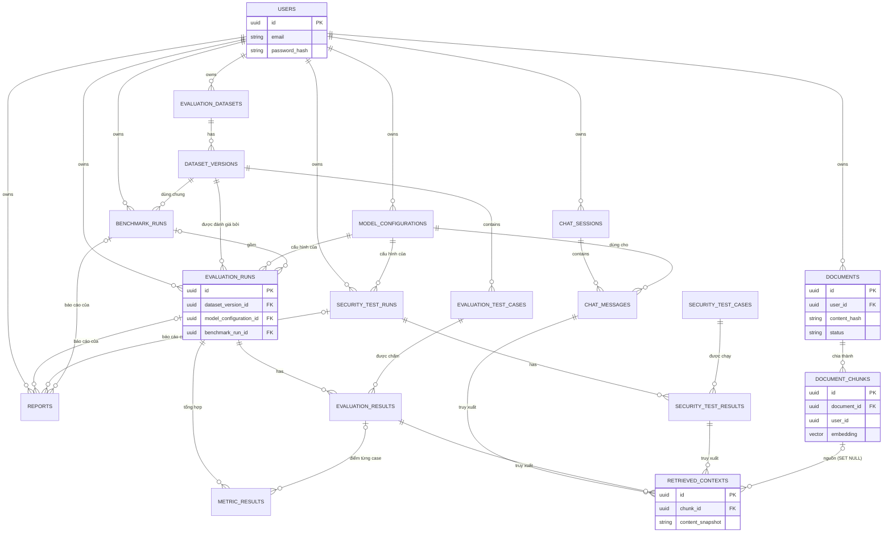

# 07. Thiết kế Database và ER diagram (M1-T07)

Trạng thái: bản nháp chờ duyệt. Đây là thiết kế ở mức logic; kiểu dữ liệu và tên cột sẽ được hiện thực bằng migration ở các milestone tương ứng. Ba điểm thiết kế đáng bàn đã được chọn kèm lý do ở mục 9; khái niệm nền ở mục 10.

## 1. Nguyên tắc thiết kế

- Giữ đúng 18 entity theo Master Prompt, **không thêm bảng** ngoài danh sách. Một số entity dùng cột JSONB cho phần linh hoạt thay vì tách bảng phụ.
- Khóa chính dùng UUID (không đoán được, an toàn khi lộ trong URL).
- Mọi dữ liệu thuộc về một user phải truy ngược được về `user_id` (trực tiếp hoặc qua bảng cha).
- Kết quả lịch sử (run, kết quả, ngữ cảnh đã truy xuất) phải **tự đủ nghĩa** sau khi tài liệu bị xóa hoặc reprocess, nên lưu bản chụp (snapshot) thay vì chỉ lưu tham chiếu.
- Cấu hình dùng cho run là **bất biến**: sửa cấu hình thì tạo bản ghi mới.
- Quy tắc nghiệp vụ không thể diễn đạt bằng ràng buộc DB (ví dụ version đã duyệt là bất biến) được thực thi ở Service và có test.

## 2. Phân biệt các loại dữ liệu

| Loại | Lưu ở đâu | Ví dụ |
|------|-----------|-------|
| Metadata quan hệ | Bảng PostgreSQL | users, documents, runs |
| Vector | Cột kiểu `vector` trong `document_chunks` (pgvector) | embedding của chunk |
| File gốc | File storage (volume `uploads`), đường dẫn lưu trong `documents.storage_path` | PDF, DOCX, TXT người dùng upload |
| Dataset | Bảng `evaluation_datasets`, `dataset_versions`, `evaluation_test_cases` | Câu hỏi, ground truth |
| Test case bảo mật | File YAML trong repo (nguồn chuẩn), bản chụp được nạp vào `security_test_cases` khi chạy | `security/test_cases/*.yaml` |
| Log ứng dụng | stdout của container | Không lưu trong DB |
| Log nghiệp vụ (latency, token, chi phí) | Cột trong `chat_messages` và `evaluation_results` | Đo mỗi lượt gọi |
| Báo cáo | CSV sinh tức thì khi yêu cầu (không lưu file); lịch sử xuất ghi ở bảng `reports` | CSV |

### Vector gắn với chunk thế nào

Vector nằm **ngay trong hàng của chunk** (`document_chunks.embedding`), quan hệ 1 chunk : 1 vector, không có bảng vector riêng. Nhờ vậy:
- Một câu truy vấn có thể vừa tìm theo vector vừa lọc theo `user_id` và `document_id` trong cùng bảng, không cần join.
- Xóa chunk là xóa luôn vector, không có vector mồ côi.

Cột vector có số chiều cố định. Mỗi chunk lưu `embedding_model` để phát hiện chunk nào được embed bằng model khác và tránh trộn vector không so sánh được.

## 3. Danh sách entity

Quy ước: PK là khóa chính, FK là khóa ngoại. `ts` là timestamp. Các cột `created_at` có ở mọi bảng nên không lặp lại.

### 3.1 Tài khoản

#### users
- **Mục đích**: tài khoản đăng nhập, chủ sở hữu mọi dữ liệu.
- **Cột**: `id` PK, `email` (duy nhất), `password_hash`, `is_active`, `created_at`.
- **Quan hệ**: một user có nhiều document, session, dataset, run, cấu hình.
- **Ownership**: bản thân là chủ thể.
- **Index**: duy nhất trên `email`.
- **Retention**: giữ đến khi user xóa tài khoản; xóa user xóa toàn bộ dữ liệu của họ (cascade).

### 3.2 Tài liệu và vector

#### documents
- **Mục đích**: metadata của file đã upload, trạng thái xử lý.
- **Cột**: `id` PK, `user_id` FK, `filename`, `content_type`, `size_bytes`, `content_hash` (hash nội dung để phát hiện trùng), `storage_path`, `status` (uploaded, processing, ready, failed), `error_message`, `processing_config` (JSONB: chunk size, overlap, embedding model đã dùng), `created_at`, `updated_at`.
- **Quan hệ**: thuộc một user; có nhiều chunk.
- **Ownership**: `user_id`.
- **Index**: duy nhất `(user_id, content_hash)`; `(user_id, created_at)`; `status` cho việc tìm tài liệu kẹt ở processing.
- **Retention**: giữ đến khi user xóa. Xóa document: xóa chunk (cascade), xóa file gốc, giữ bản chụp trong `retrieved_contexts`.

#### document_chunks
- **Mục đích**: đơn vị truy xuất của RAG; chứa văn bản chunk và vector.
- **Cột**: `id` PK, `document_id` FK, `user_id` (sao chép từ document để lọc nhanh), `chunk_index`, `content`, `page_number` (nullable), `char_start`, `char_end`, `embedding` (vector N chiều), `embedding_model`, `created_at`.
- **Quan hệ**: thuộc một document.
- **Ownership**: `user_id` (denormalize có chủ đích).
- **Index**: duy nhất `(document_id, chunk_index)`; `user_id`; chưa tạo chỉ mục vector ở M3-T01 (quét chính xác cho kết quả đúng với dữ liệu nhỏ và tránh việc lọc `user_id` làm chỉ mục gần đúng trả thiếu); thêm HNSW hoặc IVFFlat khi đo thấy cần.
- **Retention**: theo document; reprocess xóa chunk cũ và ghi chunk mới trong cùng transaction.
- **Lý do `user_id` denormalize**: lọc quyền ngay trong câu truy vấn vector không cần join, và nếu lập trình viên quên lọc ở tầng trên thì cột này vẫn là rào chắn thứ hai. Đổi lại phải đảm bảo `chunk.user_id = document.user_id`. **Đã thực thi bằng khóa ngoại kép** `(document_id, user_id)` trỏ tới `documents(id, user_id)` (migration `0002`), nên DB từ chối chunk có `user_id` khác chủ của document (kiểm tra bằng ràng buộc hoặc test).

### 3.3 Chat

#### chat_sessions
- **Mục đích**: một cuộc hội thoại.
- **Cột**: `id` PK, `user_id` FK, `title`, `created_at`.
- **Index**: `(user_id, created_at)`.
- **Retention**: giữ đến khi user xóa session (cascade tới message).

#### chat_messages
- **Mục đích**: từng câu hỏi và câu trả lời.
- **Cột**: `id` PK, `session_id` FK, `role` (user, assistant), `content`, `model_configuration_id` FK (nullable, chỉ message assistant), `insufficient_context` (boolean), `latency_ms`, `prompt_tokens`, `completion_tokens`, `estimated_cost`, `error_message`, `created_at`.
- **Ownership**: qua `chat_sessions.user_id`.
- **Index**: `(session_id, created_at)`.
- **Retention**: theo session.

#### retrieved_contexts
- **Mục đích**: chunk nào đã được truy xuất cho một lần chạy pipeline, kèm điểm; phục vụ trích dẫn, phân tích lỗi và tái lập.
- **Cột**: `id` PK, `chat_message_id` FK (nullable), `evaluation_result_id` FK (nullable), `security_test_result_id` FK (nullable), `chunk_id` FK (nullable, SET NULL khi chunk bị xóa), `rank`, `score`, `content_snapshot` (bản chụp văn bản chunk), `document_filename_snapshot`, `page_number`, `created_at`.
- **Ràng buộc**: đúng **một** trong ba cột FK chủ (`chat_message_id`, `evaluation_result_id`, `security_test_result_id`) khác null (CHECK). Cách này tránh khóa ngoại đa hình nhưng giữ một bảng cho cả ba luồng, đúng tinh thần "một pipeline dùng chung".
- **Ownership**: qua bản ghi chủ.
- **Index**: ba cột FK chủ (index riêng phần khác null); `chunk_id`.
- **Retention**: theo bản ghi chủ. `content_snapshot` giúp kết quả cũ vẫn đọc được sau khi tài liệu bị xóa hay reprocess.

### 3.4 Dataset

#### evaluation_datasets
- **Mục đích**: tập câu hỏi đánh giá, có tên.
- **Cột**: `id` PK, `user_id` FK, `name`, `description`, `created_at`.
- **Index**: `(user_id, name)`.
- **Retention**: giữ đến khi user xóa; **không xóa được** nếu có version đang được run tham chiếu (RESTRICT).

#### dataset_versions
- **Mục đích**: một phiên bản của dataset; đơn vị mà run tham chiếu.
- **Cột**: `id` PK, `dataset_id` FK, `version_number`, `status` (draft, reviewed), `reviewed_at`, `notes`, `created_at`.
- **Index**: duy nhất `(dataset_id, version_number)`.
- **Quy tắc**: version `reviewed` là bất biến (Service từ chối sửa, thêm, xóa test case); muốn sửa thì tạo version mới (có thể sao chép từ version trước).
- **Retention**: giữ; xóa bị RESTRICT nếu có run tham chiếu.

#### evaluation_test_cases
- **Mục đích**: một câu hỏi đánh giá.
- **Cột**: `id` PK, `dataset_version_id` FK, `question`, `ground_truth_answer` (nullable, trống với câu không có đáp án), `reference_contexts` (JSONB, xem dưới), `source_note`, `question_type` (fact, multi_hop, summarization, unanswerable), `difficulty` (easy, medium, hard), `expected_behavior` (answer, insufficient_context), `created_at`.
- **Index**: `dataset_version_id`; `(dataset_version_id, question_type)`.
- **Retention**: theo version.
- **Về `reference_contexts`**: chunk id thay đổi mỗi lần reprocess hay đổi chunk size, nên **không** tham chiếu chunk id. Mỗi phần tử gồm `document_content_hash`, `char_start`, `char_end`, `text`. Một chunk được truy xuất tính là "liên quan" khi trùng khoảng ký tự với reference trong cùng tài liệu. Cách so khớp này sẽ chốt chi tiết ở M5 và M6-T02.

### 3.5 Cấu hình model

#### model_configurations
- **Mục đích**: một cấu hình RAG đặt tên, dùng cho chat, evaluation, security, benchmark.
- **Cột**: `id` PK, `user_id` FK, `name`, `llm_provider`, `llm_model`, `embedding_provider`, `embedding_model`, `prompt_version`, `top_k`, `temperature`, `chunk_size`, `chunk_overlap`, `created_at`.
- **Quy tắc**: bất biến; sửa tức là tạo bản ghi mới. `chunk_size`, `chunk_overlap`, `embedding_model` mô tả **trạng thái của corpus** khi chạy; run kiểm tra khớp với `documents.processing_config` trước khi bắt đầu và cảnh báo nếu lệch.
- **Retention**: giữ; xóa bị RESTRICT nếu có run hoặc message tham chiếu.

### 3.6 Evaluation

#### evaluation_runs
- **Mục đích**: một lần chạy đánh giá.
- **Cột**: `id` PK, `user_id` FK, `dataset_version_id` FK, `model_configuration_id` FK, `benchmark_run_id` FK (nullable), `status` (pending, running, completed, failed), `total_cases`, `completed_cases`, `failed_cases`, `judge_model`, `judge_prompt_version`, `environment` (JSONB: version framework và thư viện, snapshot cấu hình ingestion của corpus), `started_at`, `finished_at`, `created_at`.
- **Index**: `(user_id, created_at)`; `dataset_version_id`; `benchmark_run_id`; `status`.
- **Retention**: giữ lâu dài (lịch sử run là một phần giá trị của dự án); user có thể xóa thủ công.

#### evaluation_results
- **Mục đích**: kết quả của từng test case trong một run.
- **Cột**: `id` PK, `run_id` FK, `test_case_id` FK, `status` (ok, error), `answer`, `insufficient_context` (boolean), `error_message`, `latency_ms`, `prompt_tokens`, `completion_tokens`, `estimated_cost`, `created_at`.
- **Index**: duy nhất `(run_id, test_case_id)`.
- **Retention**: theo run.

#### metric_results
- **Mục đích**: điểm của từng metric, ở mức case hoặc mức run (tổng hợp).
- **Cột**: `id` PK, `run_id` FK, `evaluation_result_id` FK (nullable: trống nghĩa là điểm tổng hợp của run), `metric_name`, `k` (nullable, dùng cho metric @K), `value` (nullable khi không tính được), `method` (deterministic, llm_judge), `status` (computed, failed), `details` (JSONB: lý do của judge hoặc thông tin lỗi), `created_at`.
- **Index**: `(run_id, metric_name)`; `evaluation_result_id`.
- **Lưu ý**: `value` để trống khi không tính được; **không điền số giả**.
- **Retention**: theo run.

### 3.7 Security Testing

#### security_test_cases
- **Mục đích**: bản chụp test case bảo mật được nạp từ YAML khi chạy.
- **Cột**: `id` PK, `case_key` (mã ổn định trong file YAML), `case_version`, `content_hash`, `category` (prompt_injection, jailbreak, data_leakage, access_control, malicious_documents), `title`, `description`, `input_payload`, `setup` (JSONB: tài liệu, user, canary token cần chuẩn bị), `expected_behavior`, `evaluation_criteria` (JSONB: luật xác định, tiêu chí judge), `default_severity`, `created_at`.
- **Index**: duy nhất `(case_key, content_hash)`; `category`.
- **Retention**: giữ để kết quả cũ truy ngược được phiên bản test case đã chạy.
- **Nguồn chuẩn**: file YAML trong repo. DB chỉ lưu bản chụp, tránh hai nguồn sự thật.

#### security_test_runs
- **Cột**: `id` PK, `user_id` FK, `model_configuration_id` FK, `status` (pending, running, completed, failed), `environment` (JSONB), `coverage_notes` (nhóm hoặc kịch bản chưa kiểm tra), `started_at`, `finished_at`, `created_at`.
- **Index**: `(user_id, created_at)`.
- **Retention**: giữ lâu dài, user xóa thủ công được.

#### security_test_results
- **Cột**: `id` PK, `run_id` FK, `test_case_id` FK, `status` (pass, fail, error), `severity`, `actual_response`, `evidence` (JSONB), `evaluator` (rule, judge), `mitigation`, `created_at`.
- **Index**: duy nhất `(run_id, test_case_id)`; `(run_id, status)`.
- **Retention**: theo run.

### 3.8 Benchmark và báo cáo

#### benchmark_runs
- **Mục đích**: nhóm các evaluation run được so sánh trong điều kiện đồng nhất.
- **Cột**: `id` PK, `user_id` FK, `dataset_version_id` FK, `name`, `varied_variable` (một trong `llm_model`, `top_k`, `prompt_version`), `status` (pending, running, completed, failed), `notes`, `started_at`, `finished_at`, `created_at`.
- **Quan hệ**: có nhiều `evaluation_runs` (qua `benchmark_run_id`).
- **Retention**: giữ lâu dài.

#### reports
- **Mục đích**: ghi nhận một báo cáo đã xuất.
- **Cột**: `id` PK, `user_id` FK, `report_type` (evaluation, security, benchmark), `evaluation_run_id` FK (nullable), `security_test_run_id` FK (nullable), `benchmark_run_id` FK (nullable), `format` (csv; pdf là deferred), `created_at`.
- **Ràng buộc**: đúng một trong ba cột FK run khác null (CHECK).
- **Retention**: theo run; file xuất có thể tạo lại nên xóa an toàn.

## 4. ER diagram

(Sơ đồ rút gọn cột để dễ đọc; danh sách cột đầy đủ ở mục 3.)

## 5. Quy tắc cô lập dữ liệu theo user

1. Mọi hàm Repository nhận `user_id` và luôn lọc theo nó; không có hàm "lấy theo id" không kèm điều kiện sở hữu cho dữ liệu của user.
2. Truy cập tài nguyên không thuộc user trả **404** (không phải 403) để không lộ sự tồn tại.
3. **Retrieval**: câu truy vấn vector luôn có điều kiện `user_id`, và tùy chọn thêm `document_id IN (...)`. Điều kiện nằm trong SQL, không lọc sau khi lấy kết quả.
4. Cột `document_chunks.user_id` là rào chắn thứ hai ở tầng dữ liệu (xem mục 3.2).
5. Test bắt buộc: user A không đọc, sửa, xóa được tài nguyên của user B qua API, và không bao giờ nhận chunk của B từ retrieval, kể cả khi câu hỏi nhắm vào nội dung đó.
6. Cân nhắc thêm Row Level Security của PostgreSQL ở giai đoạn sau (Optional, chưa thuộc MVP).

## 6. Quy tắc xóa và cascade

| Hành động | Hành vi |
|-----------|---------|
| Xóa user | Cascade toàn bộ dữ liệu của user. Vì có khóa RESTRICT, Service xóa theo thứ tự (run, benchmark, dataset, cấu hình) trong một transaction. MVP **không** mở endpoint xóa tài khoản |
| Xóa document | Cascade xóa `document_chunks`; `retrieved_contexts.chunk_id` thành NULL, giữ nguyên bản chụp; xóa file gốc trong storage |
| Reprocess document | Trong một transaction: xóa chunk cũ, ghi chunk mới; `retrieved_contexts` cũ giữ bản chụp |
| Xóa chat session | Cascade `chat_messages` và `retrieved_contexts` gắn message |
| Xóa dataset hoặc version | RESTRICT nếu có run hoặc benchmark tham chiếu |
| Xóa `model_configurations` | RESTRICT nếu có message, run tham chiếu |
| Xóa evaluation run | Cascade `evaluation_results`, `metric_results` và `retrieved_contexts` gắn kết quả; benchmark run cha không bị xóa |
| Xóa benchmark run | Không xóa các evaluation run con (chỉ gỡ liên kết, `benchmark_run_id` thành NULL) để không mất dữ liệu đo |
| Xóa security run | Cascade `security_test_results`, `retrieved_contexts` gắn kết quả đó và `reports` của run |
| Xóa `security_test_cases` | RESTRICT khi còn `security_test_results` tham chiếu (bản chụp được giữ) |
| Xóa run (evaluation, benchmark) | `reports` gắn run bị xóa theo (cascade) |

Các quy tắc ở bảng áp dụng ở tầng DB và Service. Trong MVP chỉ những hành động có endpoint ở `08_api_contracts.md` mới gọi được qua API (xóa document, chat session, test case); xóa dataset, version, cấu hình, các loại run chưa mở endpoint.

Điều này giải quyết điểm mở ở `05_sequences.md` về cascade khi xóa document.

## 7. Chỉ mục: nguyên tắc

- Chỉ tạo index cho truy vấn thật sự dùng (danh sách ở mục 3), không tạo dư.
- Chỉ mục vector được chọn và đo ở M3, không kết luận hiệu năng trước khi có số đo.
- Lọc theo `user_id` kết hợp tìm vector gần đúng có thể làm giảm số kết quả trả về của index gần đúng; cần kiểm tra ở M3-M4 khi có dữ liệu thật (ghi vào rủi ro).

## 8. Điều kiện kiểm chứng

- ERD không có bảng ngoài 18 entity của Master Prompt.
- Mọi FK trong mục 3 có dòng tương ứng trong ERD và trong bảng cascade (mục 6).
- Mọi bảng có đường truy ngược về `users` để áp dụng cô lập dữ liệu.

## 9. Quyết định đã chọn và lý do

### 9.1 Giữ `document_chunks.user_id` (denormalize có chủ đích)

**Đã chọn: giữ.** Denormalize nghĩa là lưu lặp một thông tin có thể suy ra từ bảng khác (ở đây `user_id` đã có trong `documents`). Thông thường đây là điều nên tránh vì dễ lệch dữ liệu. Ta chấp nhận ở đúng một chỗ này vì hai lý do bảo mật và hiệu năng: (1) lọc quyền ngay trong câu truy vấn vector không cần join; (2) nếu một lập trình viên quên lọc ở tầng trên, cột này vẫn là lớp phòng thủ thứ hai. Cái giá là phải bảo đảm `chunk.user_id = document.user_id`.

*Giả định yếu:* "Dữ liệu sẽ không bao giờ lệch." Cách xử lý: chỉ một nơi ghi chunk (`chunk_repository.py` khi ingest), có test kiểm tra hai giá trị bằng nhau sau ingest và sau reprocess; cân nhắc ràng buộc ở DB (khóa ngoại kép) khi viết migration ở M3-T01.

### 9.2 Benchmark MVP chỉ đổi biến phía sinh

**Đã chọn: LLM, Top-K, prompt.** Đổi chunk size hoặc embedding model đòi hỏi chunk lại và embed lại toàn bộ tài liệu, trong khi mỗi tài liệu hiện chỉ có một bộ chunk. Hỗ trợ nhiều bộ chunk song song cần thêm khái niệm "index" vào schema, đó là phức tạp chưa chứng minh được là cần. Benchmark chunking vẫn làm được ngoài MVP bằng cách reprocess tuần tự, mỗi lần chạy ghi lại `environment` (cấu hình ingestion của corpus) để so sánh có kiểm soát; việc này ghi vào danh sách Deferred.

*Giả định yếu:* "Biến phía sinh là thứ đáng so sánh nhất." Thực tế chunking thường ảnh hưởng chất lượng retrieval mạnh hơn nhiều so với đổi LLM. Vì vậy `03_mvp_scope.md` ghi rõ đây là giới hạn của benchmark MVP và báo cáo không được kết luận về chunking.

### 9.3 Bất biến của version đã duyệt

**Đã chọn: thực thi ở Service, có test.** Lý do: quy tắc nghiệp vụ nằm ở một nơi dễ đọc và dễ test. Có thể thêm trigger ở DB nếu sau này muốn chắc hơn (Optional). *Giả định yếu:* "mọi đường sửa đều đi qua Service." Cách xử lý: Repository không có hàm sửa test case của version đã duyệt, và test cố sửa phải bị từ chối.

## 10. Giải thích khái niệm cho người mới

- **Primary key (PK) và Foreign key (FK)**: PK là cột định danh duy nhất mỗi hàng; FK là cột trỏ tới PK của bảng khác để thể hiện quan hệ (ví dụ `documents.user_id` trỏ tới `users.id`).
- **UUID thay vì số tự tăng**: số tự tăng đoán được (`/documents/1`, `/documents/2`), nên kẻ tấn công có thể dò tài nguyên của người khác. UUID khó đoán hơn, nhưng **không thay thế** kiểm tra quyền sở hữu; vì thế vẫn trả 404 khi không thuộc user.
- **Cascade, RESTRICT, SET NULL**: quy tắc khi xóa một hàng cha. CASCADE xóa luôn hàng con; RESTRICT từ chối xóa nếu còn hàng con tham chiếu; SET NULL giữ hàng con và bỏ liên kết. Chọn sai là mất dữ liệu lịch sử hoặc để lại dữ liệu mồ côi.
- **Snapshot (bản chụp)**: sao chép nội dung tại thời điểm xảy ra thay vì chỉ lưu tham chiếu. `retrieved_contexts.content_snapshot` giữ văn bản chunk đã dùng, nên kết quả đánh giá cũ vẫn đọc được dù tài liệu đã bị xóa hoặc chunk lại. Đây là điều kiện để tái lập và phân tích lỗi.
- **JSONB**: kiểu dữ liệu JSON của PostgreSQL, dùng cho phần cấu trúc linh hoạt (ví dụ `environment`, `evidence`). Không dùng cho dữ liệu cần truy vấn và ràng buộc thường xuyên, những cái đó nên là cột thật.
- **Index**: cấu trúc giúp tìm nhanh, đổi lại làm ghi chậm hơn và tốn chỗ. Chỉ tạo cho truy vấn thật sự dùng.
- **Row Level Security (RLS)**: tính năng PostgreSQL ép quy tắc "mỗi user chỉ thấy hàng của mình" ngay trong DB. Mạnh hơn lọc ở code nhưng phức tạp để học và test; để Optional sau MVP.
- **Transaction**: transaction gom nhiều thao tác DB thành một khối "hoặc làm hết hoặc không làm gì". Reprocess dùng transaction để không bao giờ để tài liệu ở trạng thái chunk cũ bị xóa nhưng chunk mới chưa ghi.
