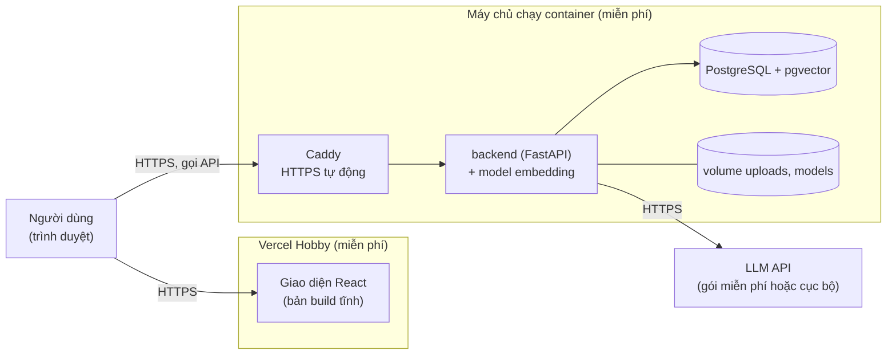

# 11. Kế hoạch triển khai miễn phí lên internet

Trạng thái: bản nháp chờ duyệt. Ra đời từ yêu cầu mới của user (2026-11-05): sản phẩm có giao diện tương tác, chạy được trên internet, **không tốn tiền**. Mục này bổ sung cho `06_deployment_tech.md` (cách chạy cục bộ bằng Docker Compose), không thay thế nó.

Quy ước đánh dấu: **[đã xác minh]** là điều đọc từ nguồn chính thức hoặc đã thử trong dự án; **[chưa xác minh]** là điều từ nguồn thứ cấp hoặc suy luận, phải kiểm tra lại trước khi dựa vào. Điều khoản miễn phí đổi liên tục, nên mọi con số dưới đây chỉ có giá trị tại thời điểm tra (2026-11).

## 1. Nguyên tắc

1. **Phát triển và học luôn miễn phí và chạy cục bộ** (Docker Compose). Đây là nền, không đổi.
2. **Bản internet là bản demo cho mục đích học**, không phải dịch vụ thương mại. Chấp nhận: dịch vụ có thể ngủ, dung lượng nhỏ, hạn mức thấp.
3. **Mã nguồn không phụ thuộc vào nhà cung cấp cụ thể.** Nơi lưu file, embedding và LLM đều nằm sau adapter để đổi được mà không viết lại.
4. **Không bao giờ để secret trong repo hay trong biến môi trường của giao diện** (mọi biến `VITE_*` đều lộ công khai trong trình duyệt).

## 2. Vì sao không đặt toàn bộ lên Vercel

| Giới hạn của Vercel | Hệ quả với dự án |
|---------------------|------------------|
| Hàm Python có giới hạn dung lượng 500 MB, thời gian chạy tối đa (Hobby mặc định 300 giây), body request tối đa 4,5 MB **[đã xác minh từ tài liệu Vercel]** | Model embedding và các tác vụ nền (ingestion, evaluation) chạy lâu không vừa; upload file lớn qua hàm bị chặn |
| Không có ổ đĩa ghi bền vững cho hàm **[chưa xác minh]** | Không lưu được file upload và model |
| Vercel Postgres đã ngừng, database đến từ Marketplace (Neon, Supabase...) **[đã xác minh]** | Database nằm ngoài Vercel dù thế nào |
| Gói Hobby chỉ cho dùng cá nhân, phi thương mại **[đã xác minh]** | Phù hợp mục đích học; không dùng cho dịch vụ có thu phí |

**Kết luận:** Vercel chỉ dùng cho **giao diện** (rất hợp, miễn phí). Backend, database và model chạy ở nơi chạy được container.

## 3. Kiến trúc triển khai đề xuất

Giao diện (Vercel) gọi API qua HTTPS. **API bắt buộc phải có HTTPS**: trình duyệt chặn trang HTTPS gọi API HTTP (lỗi mixed content). Hai cách có HTTPS miễn phí, cần chọn khi triển khai:
- Caddy chạy cạnh backend, tự xin chứng chỉ miễn phí, cần một tên miền (tên miền phụ miễn phí từ dịch vụ DNS động).
- Đường hầm miễn phí kiểu Cloudflare Tunnel (không cần mở cổng, cần tài khoản Cloudflare). **[chưa xác minh điều khoản hiện tại]**

## 4. Hai phương án cho phần backend

### Phương án A (đề xuất): một máy chủ miễn phí chạy cả Compose

Dùng một máy chủ ảo miễn phí đủ RAM để chạy nguyên bộ `docker compose` hiện có (db, backend kèm model embedding). Ứng viên: **Oracle Cloud Always Free** **[chưa xác minh]**, theo nguồn thứ cấp là máy chủ đầy đủ miễn phí nhưng cần thẻ để xác minh tài khoản.

- **Ưu:** gần như không phải sửa code; giữ model embedding cục bộ (384 chiều, không đổi); giữ nguyên database và tác vụ nền; không bị giới hạn 512 MB RAM.
- **Nhược và điều chưa biết:** cần thẻ để xác minh (không bị tính tiền nếu giữ trong hạn mức); không rõ máy ARM miễn phí có sẵn khi đăng ký hay không; không rõ chính sách thu hồi máy rảnh; bạn phải tự bảo trì máy (cập nhật, sao lưu).

### Phương án B (dự phòng, nếu không có thẻ hoặc không lấy được máy chủ)

Ghép các dịch vụ miễn phí rời nhau:

| Phần | Dịch vụ | Giới hạn đã biết |
|------|---------|------------------|
| Database | Neon hoặc Supabase gói miễn phí | Neon khoảng 0,5 GB và hạn mức giờ tính toán, vượt thì tạm dừng; Supabase khoảng 500 MB, tự tạm dừng sau một tuần ít hoạt động; **chưa xác nhận bật được pgvector ở gói miễn phí** |
| Backend | Dịch vụ container có gói miễn phí | Thường ngủ khi rảnh và RAM khoảng 512 MB **[chưa xác minh]** |
| File | Lưu trữ tương thích S3 miễn phí | Hạn mức chưa xác minh |
| Embedding | **API thay cho model cục bộ** | Model cục bộ **không vừa 512 MB RAM** (đã đo: khoảng 0,93 GB, xem mục 4.1); đổi sang API đồng nghĩa số chiều vector có thể đổi và phải có migration |

Phương án B đòi hỏi sửa nhiều hơn và chất lượng trải nghiệm kém hơn (ngủ, giới hạn). Chỉ chọn khi A không thực hiện được.

### 4.1 Số đo thật của backend (đo ngày 2026-11-05 trong container, máy phát triển)

| Số đo | Giá trị |
|-------|---------|
| RAM của tiến trình backend sau khi nạp model embedding | **khoảng 933 MB** (đỉnh 957 MB), trước khi nạp là 14 MB |
| Kích thước image backend (PyTorch bản CPU, sentence-transformers) | **2,2 GB** |
| Embed 32 đoạn ngắn trên CPU (sau khi nạp model) | 0,22 giây |
| Tải model lần đầu vào volume rồi nạp rồi embed | 29 giây (mạng của máy này) |
| Số chiều vector | 384 (khớp database) |

Hệ quả:
- Máy chủ cần **tối thiểu khoảng 1,5 đến 2 GB RAM** cho backend, PostgreSQL và hệ điều hành; các gói miễn phí 512 MB không chạy được model cục bộ.
- Image 2,2 GB có thể vượt giới hạn dung lượng của một số gói miễn phí. Có thể giảm bằng cách bỏ các thư viện không dùng (scikit-learn, scipy do sentence-transformers kéo theo) hoặc dùng runtime nhẹ hơn cho model; việc này để làm ở M9-T04 nếu cần.
- Số đo chỉ cho một máy và một lần chạy; đo lại trên máy đích khi triển khai.

## 5. Điều gì mình làm được và điều gì chỉ bạn làm được

| Việc | Ai làm |
|------|--------|
| Viết giao diện, đóng gói Docker, cấu hình triển khai, hướng dẫn từng bước | Mình |
| Tạo tài khoản (Vercel, nhà cung cấp máy chủ, tên miền, LLM) | **Bạn** (cần email, có thể cần thẻ) |
| Đưa secret (mật khẩu, khóa API) vào bảng cấu hình của nhà cung cấp | **Bạn** (mình không nên thấy chúng) |
| Bấm tạo máy chủ, deploy, nối tên miền | Bạn, theo hướng dẫn của mình (mình không có tài khoản của bạn) |

## 6. Việc chuẩn bị trong repo để sẵn sàng triển khai

- Giao diện tĩnh, đọc địa chỉ API từ `VITE_API_BASE_URL` lúc build (không chứa secret). **Đang có.**
- Backend đóng gói Docker, đọc mọi cấu hình từ biến môi trường. **Đang có.**
- Nơi lưu file nằm sau một module (`core/file_storage.py`), đổi sang lưu trữ đám mây khi cần. **Đang có.**
- Embedding và LLM nằm sau interface. **Embedding: M3-T06; LLM: M4.**
- Tệp cấu hình Compose cho môi trường thật (Caddy, HTTPS, không công bố cổng database), cùng hướng dẫn triển khai: **làm ở M9-T04**, sau khi chọn phương án A hay B và kiểm tra lại điều khoản miễn phí lúc đó.

## 7. Rủi ro

| Rủi ro | Cách giảm |
|--------|-----------|
| Điều khoản miễn phí đổi hoặc hết hạn | Chọn nhà cung cấp lúc triển khai thật, kiểm tra trang chính thức; không ràng buộc mã nguồn vào một nhà |
| Bản demo công khai bị lạm dụng (spam upload, gọi LLM tốn hạn mức) | Đăng ký cần mật khẩu mạnh, giới hạn dung lượng, cân nhắc giới hạn số tài khoản hoặc cần mã mời; giới hạn tần suất đăng nhập (R18) bắt buộc làm trước khi mở công khai |
| Tài liệu người dùng upload là dữ liệu thật | Chỉ dùng tài liệu bạn được phép công khai khi dùng dịch vụ bên thứ ba; đọc chính sách dữ liệu của gói miễn phí |
| Máy chủ miễn phí bị thu hồi hoặc ngủ | Có sao lưu database; ghi rõ trong README rằng đây là bản demo |
